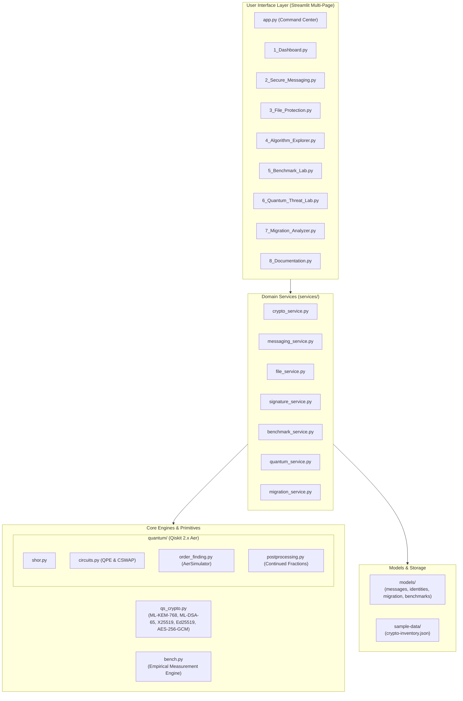

# 🛡️ Q-SHIELD — Quantum-Safe Hybrid Cryptography & Security Intelligence Platform

[](https://www.python.org/)
[](https://csrc.nist.gov/pubs/fips/203/final)
[](https://qiskit.org/)
[]()
[]()

> **Hackathon Submission:** Post-Quantum Cryptography for a Quantum-Safe Future  
> **Repository:** [https://github.com/amalshajimichaelk/Quantum_Shield](https://github.com/amalshajimichaelk/Quantum_Shield)  
> **Live App:** [https://quantumshield-404.streamlit.app/](https://quantumshield-404.streamlit.app/)   
> **Engineered by:** Principal Software Engineer, PQC Architect & Quantum Computing Researcher  

---

## 📑 Table of Contents

1. [Executive Summary & Problem Statement](#1-executive-summary--problem-statement)
2. [Proposed Solution & Capabilities](#2-proposed-solution--capabilities)
3. [End-to-End System Architecture](#3-end-to-end-system-architecture)
4. [Cryptographic Core (PQC, Classical & Hybrid)](#4-cryptographic-core-pqc-classical--hybrid)
5. [Qiskit Quantum Threat Engine (Shor's Algorithm)](#5-qiskit-quantum-threat-engine-shors-algorithm)
6. [Empirical Benchmark Laboratory](#6-empirical-benchmark-laboratory)
7. [PQC Migration Readiness Analyzer](#7-pqc-migration-readiness-analyzer)
8. [Installation & Windows PowerShell Setup](#8-installation--windows-powershell-setup)
9. [Running the Application](#9-running-the-application)
10. [Automated Test Suite](#10-automated-test-suite)
11. [3-Minute Hackathon Demonstration Script](#11-3-minute-hackathon-demonstration-script)
12. [Security Disclaimers & Limitations](#12-security-disclaimers--limitations)
13. [References & Standards](#13-references--standards)

---

## 1. Executive Summary & Problem Statement

Modern digital society relies on public-key cryptography—principally **RSA, Diffie-Hellman, and Elliptic Curve Cryptography (ECDH, ECDSA, Ed25519)**—to protect financial transactions, encrypted communications (TLS 1.3, VPNs), secure software delivery, and identity non-repudiation.

These conventional primitives base their security on the computational difficulty of two mathematical problems:
1. **Integer Factorization** ($N = p \cdot q$)
2. **Discrete Logarithms** in finite fields and elliptic curve groups ($g^x = y$)

On classical computers, the best-known algorithms (such as the General Number Field Sieve) require sub-exponential time $\mathcal{O}(\exp(c \sqrt[3]{\ln N (\ln \ln N)^2}))$, keeping keys such as RSA-2048 and Curve25519 secure against brute force.

### The Quantum Threat
In 1994, Peter Shor formulated **Shor's Quantum Algorithm**, which solves order-finding, discrete logarithms, and integer factorization in polynomial time $\mathcal{O}((\log N)^3)$ on a quantum computer. When a **Cryptographically Relevant Quantum Computer (CRQC)** is constructed:
- **All RSA, Diffie-Hellman, and Elliptic Curve keys will be broken instantly.**
- Adversaries carrying out **Harvest Now, Decrypt Later (HNDL)** attacks are actively recording encrypted network traffic today to decrypt once quantum machines come online.
- Data with confidentiality requirements exceeding 5–10 years is **already exposed**.

---

## 2. Proposed Solution & Capabilities

**Q-SHIELD** is an enterprise-grade cybersecurity and intelligence platform designed to operationalize post-quantum migration and demonstrate the quantum threat with physical precision:

- 🛡️ **Standardized PQC (NIST FIPS 203 & 204):** Genuine compiled implementations of **ML-KEM-768** (Module-LWE key encapsulation) and **ML-DSA-65** (Module-SIS digital signatures) from PQClean C code. No simulated math.
- 🔄 **Defense-in-Depth Hybrid Key Exchange:** Dual-algorithm handshake binding classical X25519 and ML-KEM-768 into HKDF-SHA256 with strict anti-downgrade policies.
- ⚛️ **Mandatory Qiskit Quantum Threat Lab:** Authentic simulation of **Shor's Factoring Algorithm** using Qiskit 2.x and Qiskit Aer, executing real Quantum Phase Estimation circuits with modular permutation gates to factor $N=15$ ($15 = 3 \times 5$).
- ⚡ **Live Wall-Clock Benchmark Lab:** Real timings (`time.perf_counter_ns()`) and byte dimensions comparing X25519, Ed25519, ML-KEM-768, and ML-DSA-65 with statistical spread (median, p95, stdev) and CSV export.
- 🧭 **Automated Migration Readiness Analyzer:** Algorithmic risk scanner applying **Mosca's Theorem** ($X + Y > Z$) and HNDL threat modeling to enterprise cryptographic inventories.
- 💬 **Multi-Party Secure Messaging:** Local Alice $\leftrightarrow$ Bob workflow with structured canonical `MessageEnvelope` objects and tamper-evident AEAD authentication.
- 📁 **Authenticated File Protection:** Arbitrary file encryption with authenticated associated data (AAD) headers and scrypt-backed keystores.

---

## 3. End-to-End System Architecture



---

## 4. Cryptographic Core (PQC, Classical & Hybrid)

Q-SHIELD provides genuine implementations of both post-quantum and classical baselines:

| Primitive | Standard | Role | Public Key Size | Wire Payload | Quantum Resistance |
|---|---|---|---|---|---|
| **ML-KEM-768** | NIST FIPS 203 | Post-Quantum KEM | 1,184 B | 1,088 B (Ciphertext) | **Resistant (Lattice M-LWE)** |
| **ML-DSA-65** | NIST FIPS 204 | Post-Quantum Signatures | 1,952 B | 3,309 B (Signature) | **Resistant (Lattice M-SIS)** |
| **X25519** | RFC 7748 | Classical Key Exchange | 32 B | 32 B (Public Key) | Broken by Shor's |
| **Ed25519** | RFC 8032 | Classical Signatures | 32 B | 64 B (Signature) | Broken by Shor's |
| **Hybrid** | Dual Standard | Defense-in-Depth KEM | 1,216 B | 1,120 B (X25519 + KEM) | **Resistant (Dual Security)** |
| **AES-256-GCM** | SP 800-38D | Authenticated AEAD | N/A (Symmetric) | 16 B (Tag) | **Resistant (128-bit quantum margin)** |

### Hybrid Key Derivation Protocol
To prevent downgrade attacks or reliance on a single algorithmic family, hybrid mode feeds both secrets into HKDF-SHA256:
$$\text{IKM} = \text{ss}_{\text{ML-KEM}} \parallel \text{ss}_{\text{X25519}}$$
$$\text{info} = \text{"QuantumShield/v1/aes256gcm/hybrid\x00"} \parallel \text{LP}(x_{\text{pub}}, x_{\text{eph}}, \text{kem}_{\text{pk}}, \text{kem}_{\text{ct}})$$
$$K_{\text{AES}} = \text{HKDF-SHA256}(\text{IKM}, \text{salt}=\text{"QuantumShield/v1/salt"}, \text{info}, 32)$$

---

## 5. Qiskit Quantum Threat Engine (Shor's Algorithm)

The **Quantum Threat Laboratory** (`pages/6_Quantum_Threat_Lab.py` and `quantum/`) implements a complete execution of Shor's factoring algorithm using the **Qiskit SDK 2.x** and **Qiskit Aer Simulator**.

```
count_0: ───[H]──────■─────────────────────────────────[IQFT]──[M]
                     │
count_1: ───[H]──────┼──────────■──────────────────────[IQFT]──[M]
                     │          │
count_2: ───[H]──────┼──────────┼──────────■───────────[IQFT]──[M]
                     │          │          │
count_3: ───[H]──────┼──────────┼──────────┼───────────[IQFT]──[M]
                   ┌─┴─┐      ┌─┴─┐      ┌─┴─┐
 work_0: ───[X]────┤   ├──────┤   ├──────┤   ├────────────────────
                   │   │      │   │      │   │
 work_1: ──────────┤ U ├──────┤ U²├──────┤ U⁴├────────────────────
                   │   │      │   │      │   │
 work_2: ──────────┤   ├──────┤   ├──────┤   ├────────────────────
                   │   │      │   │      │   │
 work_3: ──────────┤   ├──────┤   ├──────┤   ├────────────────────
                   └───┘      └───┘      └───┘
```

1. **Target Parameters:** Factoring $N = 15$ using base $a = 2$.
2. **Quantum Register:** 4 counting qubits ($2^4 = 16$ phase bins) in uniform superposition + 4 work qubits initialized to $|1\rangle = |0001\rangle$.
3. **Controlled Modular Exponentiation:** Built using controlled-SWAP (Fredkin) gates preserving the exact permutations $x \mapsto 2^j \cdot x \pmod{15}$.
4. **Inverse Quantum Fourier Transform (IQFT):** Extracts the phase kickback into computational basis states.
5. **Measurement & Classical Post-Processing:** 1,024 shots measured on `AerSimulator`. Phase estimation concentrates on bitstrings `0000`, `0100`, `1000`, and `1100`.
6. **Continued Fractions Expansion:** Recovers phase $\theta = 0.25 = 1/4 \implies r = 4$.
7. **Factor Extraction:** Computes $\gcd(2^{4/2} - 1, 15) = 3$ and $\gcd(2^{4/2} + 1, 15) = 5$, mathematically verifying:
$$15 = 3 \times 5$$

---

## 6. Empirical Benchmark Laboratory

The Benchmark Lab (`pages/5_Benchmark_Lab.py` and `bench.py`) collects authentic wall-clock metrics directly on your host machine:

- **Key Generation:** X25519 vs. Ed25519 vs. ML-KEM-768 vs. ML-DSA-65 vs. Hybrid.
- **Key Establishment:** X25519 ECDH vs. ML-KEM Encapsulation & Decapsulation.
- **Digital Signatures:** Ed25519 Sign/Verify vs. ML-DSA-65 Sign/Verify.
- **AEAD Encryption:** AES-256-GCM Encrypt & Decrypt across multiple payload sizes.
- **Metrics Collected:** Median, Mean, Minimum, Maximum, 95th Percentile ($p95$), Standard Deviation, and exact byte counts.
- **CSV Export:** One-click download of all raw measurement records.

---

## 7. PQC Migration Readiness Analyzer

The Migration Analyzer (`pages/7_Migration_Analyzer.py` and `services/migration_service.py`) automates organizational cryptographic risk assessment:

- **Mosca's Theorem Assessment:** Evaluates $X + Y > Z$, where $X$ is data confidentiality lifetime, $Y$ is migration execution time, and $Z$ is time until a quantum computer arrives ($\approx 8$ years).
- **HNDL Flagging:** Flags internet-exposed public-key key exchange assets as **CRITICAL URGENCY**.
- **Cryptographic Inventory:** Supports uploading custom JSON inventories or loading the bundled enterprise profile (`sample-data/crypto-inventory.json`).
- **NIST FIPS 203/204 Roadmaps:** Recommends specific replacement algorithms, assesses packet MTU and signature bandwidth impacts, and exports findings to structured JSON and executive Markdown reports.

---

## 8. Installation & Windows PowerShell Setup

The platform is fully reproducible on Windows 11/10 (PowerShell), Linux, and macOS.

### Prerequisites
- Python 3.10, 3.11, 3.12, or 3.13 (AMD64)
- Git

### Windows PowerShell Commands

```powershell
# 1. Clone repository
git clone https://github.com/amalshajimichaelk/Quantum_Shield.git
cd Quantum_Shield

# 2. (Optional) Create and activate virtual environment
python -m venv .venv
.\.venv\Scripts\Activate.ps1

# 3. Install core dependencies
pip install -r requirements.txt

# 4. Install dev dependencies (pytest, cross-check libraries)
pip install -r requirements-dev.txt
```

---

## 9. Running the Application

Launch the Streamlit cybersecurity dashboard locally:

```powershell
streamlit run app.py
```

The application will open automatically in your browser at `http://localhost:8501`.

### Navigation
Use the sidebar navigation to move between modules:
- `1_Dashboard.py` — Executive status, platform capabilities, and live self-test.
- `2_Secure_Messaging.py` — Alice $\leftrightarrow$ Bob multi-party secure messaging.
- `3_File_Protection.py` — File encryption, tamper rejection, and keystores.
- `4_Algorithm_Explorer.py` — NIST standards, parameter sizes, and lattice math.
- `5_Benchmark_Lab.py` — Wall-clock latency benchmarks and CSV export.
- `6_Quantum_Threat_Lab.py` — Qiskit Shor's algorithm quantum factoring experiment.
- `7_Migration_Analyzer.py` — Cryptographic inventory scanner and Mosca analyzer.
- `8_Documentation.py` — Interactive engineering documentation portal.

---

## 10. Automated Test Suite

Run the full automated test suite using `pytest`:

```powershell
pytest -v
```

### Test Coverage Summary (80+ Tests Passing):
- `tests/test_crypto.py`: FIPS sizes, KEM implicit rejection, pure-Python interop (`kyber-py`, `dilithium-py`), tamper detection, downgrade rejection.
- `tests/test_quantum.py`: Quantum circuit construction, registers, inverse QFT, Qiskit Aer simulation, continued fractions, factor extraction.
- `tests/test_signatures.py`: Classical Ed25519 roundtrip, tamper detection, ML-DSA-65 comparison, keystore persistence.
- `tests/test_messaging.py`: Multi-party Alice/Bob workflow, envelope serialization, canonical signature verification, tamper rejection.
- `tests/test_files.py`: Authenticated file protection, recovery, corruption rejection, empty file validation.
- `tests/test_migration.py`: Mosca condition calculation, HNDL risk classification, sample inventory evaluation, JSON/Markdown export.
- `tests/test_bench.py`: Timing statistics (`p95`, median), serialized size verification, CSV serialization.
- `tests/test_app.py`: Streamlit AppTest page rendering and UI smoke tests.

---

## 11. 3-Minute Hackathon Demonstration Script

Follow this sequence for a compelling live judging presentation:

| Step | Time | Module | Demonstration Action | Key Takeaway for Judges |
|---|---|---|---|---|
| **1** | 0:00–0:40 | **6. Quantum Threat Lab** | Select $N=15, a=2$. Click **Execute Quantum Circuit**. Point out the real 8-qubit QPE circuit, the Aer measurement histogram, and the recovered factors $15 = 3 \times 5$. | Proves the quantum threat to RSA/ECC using a genuine Qiskit circuit, not a simulation or mockup. |
| **2** | 0:40–1:20 | **2. Secure Messaging** | Select **Hybrid (X25519 ‖ ML-KEM-768)** and **ML-DSA-65**. Click **Encrypt & Transmit**. Show the structured envelope. Tick **Simulate Attacker: Modify ciphertext byte** and click **Decrypt**. Show immediate cryptographic rejection. | Shows complete sender/receiver workflow with NIST FIPS 203/204 and AEAD tamper protection. |
| **3** | 1:20–1:50 | **5. Benchmark Lab** | Click **Run Full Benchmark Suite**. Toggle **Logarithmic scale**. Compare Ed25519 (microseconds, 64 B) vs ML-DSA-65 (milliseconds, 3,309 B). Show wire size bar charts. | Highlights real empirical trade-offs: lattice security vs. transmission bandwidth. |
| **4** | 1:50–2:30 | **7. Migration Analyzer** | Click **Load Enterprise Sample Inventory**. Point out the **Posture Score**, the Mosca theorem alerts ($X + Y > Z$), and the **Harvest-Now-Decrypt-Later** warnings. Download the Markdown report. | Provides enterprise decision-makers with an actionable, automated transition roadmap. |
| **5** | 2:30–3:00 | **1. Dashboard** | Click **Run Full Cryptographic Self-Test**. Show all green passing indicators across classical, PQC, and hybrid modes. | Demonstrates reproducibility, robustness, and production-grade engineering rigor. |

---

## 12. Security Disclaimers & Limitations

1. **Hackathon Prototype / Educational Reference:** Q-SHIELD is an educational and reference prototype designed to demonstrate post-quantum cryptographic upgrade paths. It has not undergone formal third-party cryptographic auditing and should not be used directly in safety-critical production infrastructure without certification.
2. **Local Workflow Context:** Multi-party secure messaging executes locally to demonstrate cryptographic envelope structures and AEAD verification mechanics.
3. **No Constant-Time Guarantees:** Python does not guarantee constant-time execution against cache-timing side-channel attacks. Production PQC must reside in hardened HSMs or validated C/Rust hardware modules.
4. **Simulator vs Physical Hardware:** The Shor's factoring experiment runs on the local Qiskit Aer simulator. Factoring RSA-2048 in the real world will require millions of physical fault-tolerant qubits with quantum error correction.

---

## 13. References & Standards

- **NIST FIPS 203:** *Module-Lattice-Based Key-Encapsulation Mechanism Standard (ML-KEM)*, August 2024.
- **NIST FIPS 204:** *Module-Lattice-Based Digital Signature Standard (ML-DSA)*, August 2024.
- **NIST FIPS 205:** *Stateless Hash-Based Digital Signature Standard (SLH-DSA)*, August 2024.
- **RFC 7748:** *Elliptic Curves for Security (X25519 & X448)*, IETF, 2016.
- **RFC 8032:** *Edwards-Curve Digital Signature Algorithm (Ed25519)*, IETF, 2017.
- **NIST SP 800-38D:** *Recommendation for Block Cipher Modes of Operation: Galois/Counter Mode (GCM)*.
- **Shor, Peter W.:** *"Algorithms for quantum computation: discrete logarithms and factoring"*, FOCS 1994.
- **Mosca, Michele:** *"Cybersecurity in an Era with Quantum Computers: Will We Be Ready?"*, IEEE Security & Privacy, 2018.
- **Qiskit Documentation:** [https://docs.quantum.ibm.com/](https://docs.quantum.ibm.com/)
