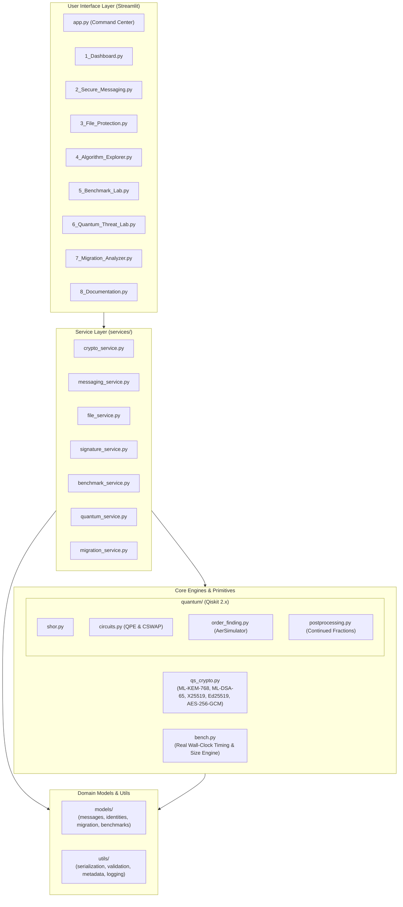
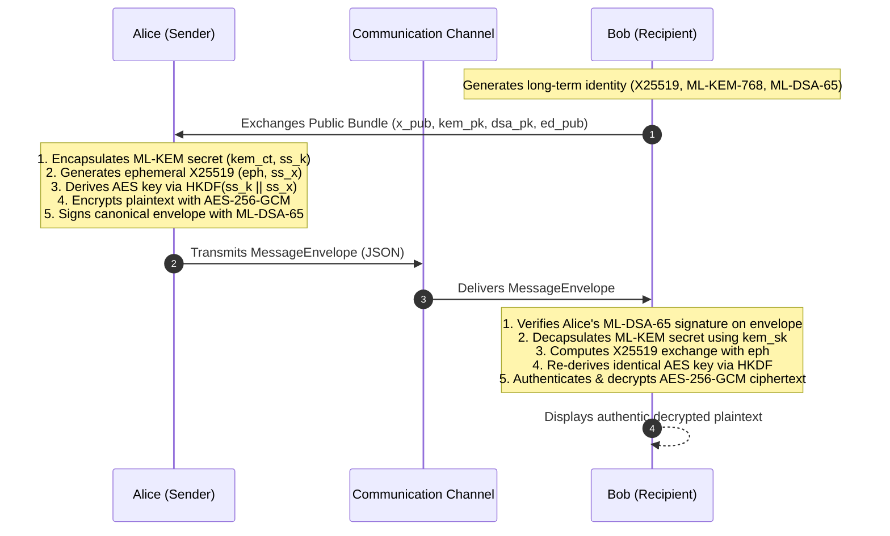

# Q-SHIELD Platform Architecture & System Design

**Project Name:** Q-SHIELD — Quantum-Safe Hybrid Cryptography & Security Intelligence Platform  
**Architecture Classification:** Enterprise Cybersecurity Platform / Post-Quantum Cryptographic Suite  
**Programming Language:** Python 3.13  
**UI Framework:** Streamlit  
**Quantum Framework:** Qiskit SDK 2.x & Qiskit Aer Simulator  

---

## 1. System Architecture Overview

Q-SHIELD is an end-to-end post-quantum cryptographic security platform designed to address the catastrophic risk quantum computing poses to modern public-key cryptography. It combines standardized post-quantum algorithms (NIST FIPS 203 ML-KEM-768 and FIPS 204 ML-DSA-65), defense-in-depth hybrid key establishment, an authentic Qiskit-powered Shor's factoring quantum simulator, a wall-clock performance benchmarking laboratory, and an automated migration readiness analyzer.

---

## 2. Component Breakdown

### 2.1 Streamlit Interface Layer (`pages/` and `app.py`)
- **`app.py`**: Central gateway providing persistent session state, identity backup/restore, and direct module dispatching.
- **`pages/1_Dashboard.py`**: Executive command dashboard showing live system status, FIPS compliance status, and live self-tests.
- **`pages/2_Secure_Messaging.py`**: Multi-party messaging simulation with Alice and Bob, structured envelopes, and real-time tampering rejection.
- **`pages/3_File_Protection.py`**: Authenticated container (`.qsh`) encryption, tamper rejection, and scrypt keystore management.
- **`pages/4_Algorithm_Explorer.py`**: Mathematical deep dive into lattice cryptography, hardness assumptions, and parameter sizes.
- **`pages/5_Benchmark_Lab.py`**: Wall-clock performance benchmarking laboratory with statistical metrics (median, mean, min, max, p95) and CSV export.
- **`pages/6_Quantum_Threat_Lab.py`**: Interactive quantum simulation executing Shor's factoring algorithm using Qiskit Aer.
- **`pages/7_Migration_Analyzer.py`**: Automated organizational inventory risk analyzer based on Mosca's theorem and HNDL threat modeling.
- **`pages/8_Documentation.py`**: Interactive engineering reference portal.

### 2.2 Core Cryptographic Engine (`qs_crypto.py`)
- **NIST FIPS 203 (ML-KEM-768):** Lattice-based key encapsulation mechanism based on Module Learning with Errors (M-LWE).
- **NIST FIPS 204 (ML-DSA-65):** Lattice-based digital signature algorithm based on Module Short Integer Solution (M-SIS).
- **RFC 7748 (X25519):** Classical Montgomery curve Diffie-Hellman key exchange for baseline comparison.
- **RFC 8032 (Ed25519):** Classical Edwards curve digital signature algorithm for baseline comparison.
- **NIST FIPS 197 / SP 800-38D (AES-256-GCM):** Authenticated encryption with associated data providing AEAD security.
- **RFC 5869 (HKDF-SHA256):** Domain-separated key derivation function with length-prefixed public context binding.
- **Passphrase-Protected Keystore:** Password-based key derivation using Scrypt ($N=2^{15}, r=8, p=1$) and AES-256-GCM.

### 2.3 Quantum Threat Engine (`quantum/`)
- **`circuits.py`**: Constructs genuine Quantum Phase Estimation (QPE) circuits containing counting registers, work registers, Hadamards, controlled modular exponentiation gates (CSWAP / unitary permutations), and inverse QFT.
- **`order_finding.py`**: Manages circuit transpilation with `qiskit.transpile()` and executes runs on `qiskit_aer.AerSimulator`.
- **`postprocessing.py`**: Performs continued fraction expansion on measured bitstring phase angles, estimates order $r$, computes $\gcd(a^{r/2} \pm 1, N)$, and verifies non-trivial factorization.
- **`shor.py`**: Orchestrates the entire quantum workflow and returns a typed `ShorResult`.

### 2.4 Migration Intelligence Engine (`services/migration_service.py`)
- Evaluates assets against quantum vulnerabilities.
- Models **Mosca's Theorem**: $X + Y > Z$, where $X$ is confidentiality lifetime, $Y$ is migration execution time, and $Z$ is time until a Cryptographically Relevant Quantum Computer (CRQC).
- Identifies **Harvest Now, Decrypt Later (HNDL)** exposures for internet-facing public-key key exchange channels.
- Calculates organizational security posture score (0–100) and exports structured JSON and Markdown audit reports.

---

## 3. Data Flow Architecture

### 3.1 Multi-Party Secure Messaging Data Flow

### 3.2 Shor's Algorithm Execution Flow

```mermaid
flowchart LR
    IN["Input: N=15, a=2"] --> PREP["Hadamard Superposition on 4 Counting Qubits"]
    PREP --> INIT["Initialize 4 Work Qubits to |0001>"]
    INIT --> MODEXP["Controlled Modular Exponentiation: a^(2^j) mod 15 (CSWAP gates)"]
    MODEXP --> IQFT["Inverse Quantum Fourier Transform (IQFT)"]
    IQFT --> MEAS["Measure Counting Register (1024 shots)"]
    MEAS --> AER["Qiskit AerSimulator Execution"]
    AER --> CONTFRAC["Continued Fractions Expansion (s/r)"]
    CONTFRAC --> ORDER["Recover Multiplicative Order r=4"]
    ORDER --> GCD["Compute gcd(a^(r/2) ± 1, N)"]
    GCD --> OUT["Verified Factors: 15 = 3 × 5"]
```

